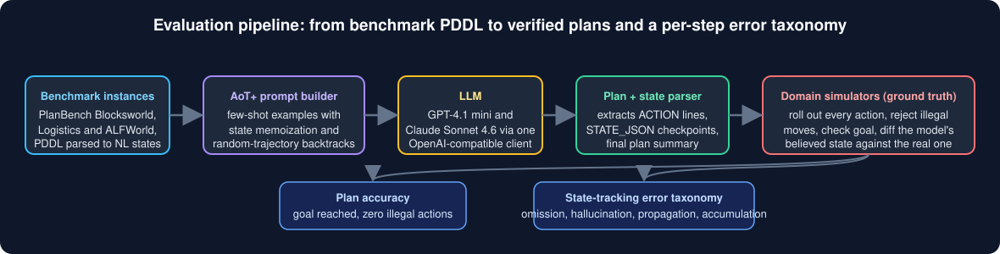
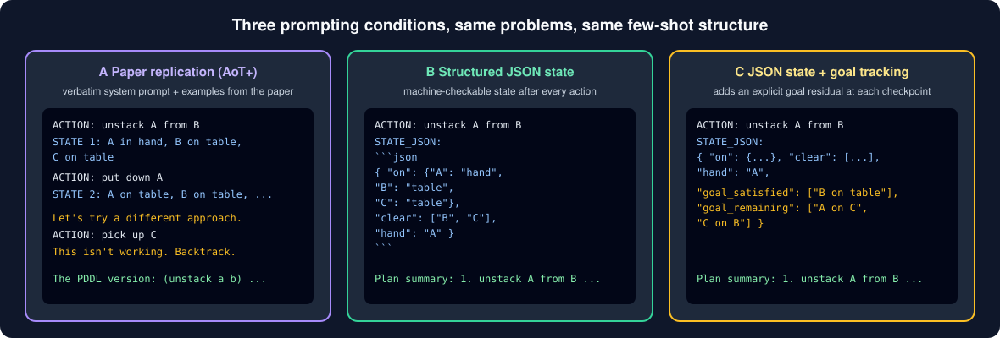
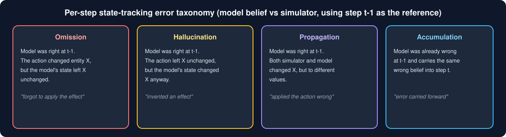
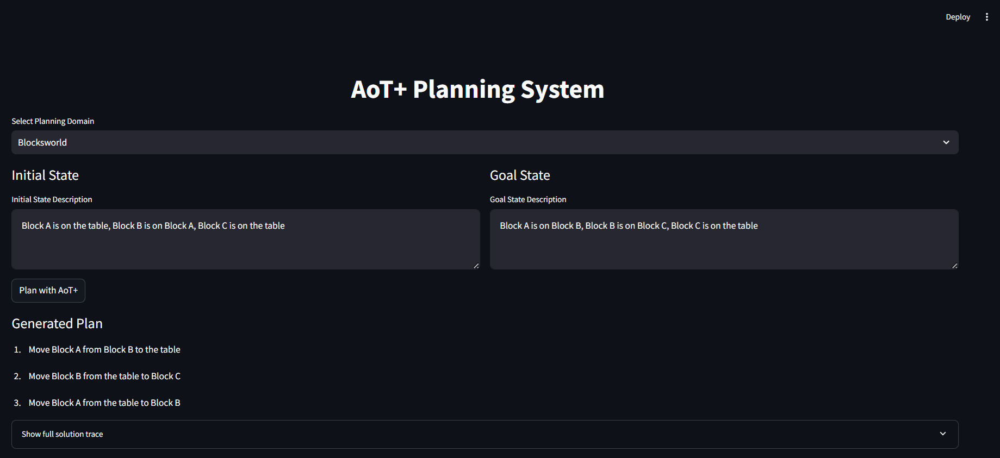

# Can LLMs Keep Track of the World While They Plan?

### Structured JSON state memoization and a per-step error taxonomy for long-horizon LLM planning, built on AoT+ (COS 484, Princeton, Spring 2026)

[](https://www.python.org/downloads/)
[](src/tests)
[](#evaluation-domains)
[](#choosing-a-model)
[](https://streamlit.io)
[](LICENSE)

> **TL;DR.** LLMs lose track of the world during multi-step planning: their belief about the environment drifts from the truth, and errors compound. *Algorithm of Thoughts+* (AoT+, [Sel, Jia & Jin, ICLR 2025](https://arxiv.org/abs/2501.13545)) fights this by having the model periodically restate the state in natural language. We ask whether the **representation** of that state matters. We replace AoT+'s free-text snapshots with a **structured JSON state** inspired by scene graphs, add a variant with explicit **goal-residual tracking**, and build a **simulator-backed, predicate-level error taxonomy** (omission, hallucination, propagation, accumulation) that the original paper does not provide. Evaluated on Blocksworld, Logistics, and ALFWorld with GPT-4.1 mini and Claude Sonnet 4.6, JSON state raised Claude's ALFWorld success rate from 46% to 86% and drove omission errors to zero everywhere, but hurt Logistics, showing a real trade-off between natural-language flexibility and symbolic state tracking.

<p align="center">
  
</p>

---

## Why this matters

A plan is only as good as the planner's running picture of the world. If a model silently "forgets" that it put block A down, every later step reasons about a world that does not exist. Plan-level accuracy hides this: a plan can fail at step 9 because of a belief error introduced at step 3.

AoT+ showed that two prompt-only ideas, **periodic state memoization** and **random-trajectory augmentation** (showing the model exploration and backtracking in its examples), push planning accuracy on classic benchmarks surprisingly high with no fine-tuning. But its state snapshots are prose, so the model has to re-parse relational structure from unstructured text at every step, and when something goes wrong it is hard to say exactly *what* the model misremembered.

This project makes the state machine-readable and the failures diagnosable:

- **Structured JSON state** that mirrors each domain's PDDL predicates, so the model reads a state, applies an action, and updates only the affected keys.
- **Goal-residual tracking** that splits the goal into `goal_satisfied` and `goal_remaining` at every checkpoint.
- **Ground-truth simulators** for Blocksworld, Logistics, and ALFWorld that execute the model's own actions in parallel and diff the model's belief against the truth at the predicate level.
- **A four-way error taxonomy** that turns "the state was wrong" into "forgot an effect", "invented an effect", "applied the action with the wrong value", or "carried an old mistake forward".

---

## What we built

<p align="center">
  
</p>

| | Component | What it does | Where |
|---|---|---|---|
| 1 | **Faithful AoT+ replication (Condition A)** | Uses the paper's verbatim system prompts and few-shot examples (Appendix B), extracts the plan from the paper's `The PDDL version:` block, and scores it exactly as the paper does. | `run_paper_repl.py`, `src/paper_replication/` |
| 2 | **Structured JSON state (Condition B)** | Re-implements AoT+ with a fenced `STATE_JSON` block after every action whose keys mirror the domain's PDDL predicates (`at`, `in`, `on`, `clear`, `city_map`, ...). Few-shot examples are rebuilt to match the paper's problem distribution. | `src/aot_plus/json_core.py`, `src/aot_plus/*_examples.py`, `run_aot_mini.py --condition B` |
| 3 | **JSON + goal residuals (Condition C)** | Adds `goal_satisfied` / `goal_remaining` fields so the model carries an explicit summary of completed and outstanding objectives through the whole trajectory. | `run_aot_mini.py --condition C` |
| 4 | **Benchmark loaders** | Downloads and caches PlanBench PDDL instances, parses them, and translates them into natural-language initial and goal states. Seeded sampling gives reproducible problem sets. | `src/benchmarks/planbench.py` |
| 5 | **Symbolic simulators** | Deterministic Blocksworld (4-operator), Logistics (trucks, airplanes, cities), and ALFWorld (navigation, openable receptacles, pick/put, clean/heat/cool/toggle/slice) world models with action-legality checks, goal checks, and NL-to-canonical state parsing. | `src/sim/`, `src/paper_replication/bw_4op_sim.py`, `src/domains/alfworld.py` |
| 6 | **Per-step error taxonomy** | Compares the model's state to the simulator at each checkpoint using step *t-1* as the reference and classifies each disagreement per entity. Also reports the first illegal step of the committed plan. | `src/eval/common_error_analysis.py`, `run_aot_mini.py`, `src/alfworld_error_eval.py` |
| 7 | **Multi-provider LLM client** | One interface over OpenAI, Azure OpenAI, Anthropic, Google, and the Princeton AI Sandbox (a Portkey gateway), so models are swapped with a single `--model` flag. | `src/models/llm_client.py` |
| 8 | **Test suite** | pytest coverage for every evaluator (AoT text, JSON structured, JSON + goal) in both PlanBench domains, plus the ALFWorld error evaluator. | `src/tests/`, `tests/` |
| 9 | **Interactive demo** | A Streamlit app to type in an initial and goal state, run AoT+, and inspect the plan and full reasoning trace. | `src/app.py` |

<p align="center">
  
</p>

---

## Evaluation domains

| Domain | Instances | Source | Why it is here |
|---|---|---|---|
| **Blocksworld** | 20 | PlanBench | Small, fully observable, deterministic. Each action touches at most two predicates, so it isolates how state format affects early reasoning failures. |
| **Logistics** | 15 | PlanBench | Long horizon (successful plans run 3 to 34 actions) across multiple vehicles, cities, and packages. Early state errors compound, stressing accumulation. |
| **ALFWorld** | 50 | TextWorld / ALFWorld | Household tasks with navigation, object manipulation, and containment. A much larger, item-rich state tests whether the model can hold a complex world model over time. |

Each domain is run under all three conditions with **GPT-4.1 mini** and **Claude Sonnet 4.6**, not to rank the models but to see how the same intervention lands on planners of different capacity. Sample sizes are modest by design: three conditions by two models by three domains, at thousands of tokens per trajectory, on a fixed API budget.

---

## Results

### Success rate (%), plan reaches the goal

| Domain | AoT+ (NL) Mini | AoT+ (NL) Sonnet | JSON Mini | JSON Sonnet | JSON + Goal Mini | JSON + Goal Sonnet |
|---|---|---|---|---|---|---|
| Blocksworld | 40.0 | 100.0 | 10.0 | 100.0 | 10.0 | 95.0 |
| Logistics | 6.7 | 80.0 | 13.3 | 40.0 | 13.3 | 40.0 |
| ALFWorld | 16.0 | **46.0** | 24.0 | **86.0** | 24.0 | 82.0 |

### Per-step error rates (errors per checkpoint), by type

| Error | Domain | AoT+ Mini | AoT+ Sonnet | JSON Mini | JSON Sonnet | JSON + Goal Mini | JSON + Goal Sonnet |
|---|---|---|---|---|---|---|---|
| Omission | BW | 0.026 | 0.013 | 0.000 | 0.000 | 0.000 | 0.000 |
| | Log | 0.000 | 0.000 | 0.000 | 0.000 | 0.000 | 0.000 |
| | ALF | 0.158 | 0.102 | 0.000 | 0.000 | 0.000 | 0.000 |
| Hallucination | BW | 0.289 | 0.050 | 0.525 | 0.000 | 0.465 | 0.011 |
| | Log | 0.638 | 1.050\* | 0.569 | 0.006 | 0.511 | 0.007 |
| | ALF | 0.978 | 0.517 | 0.779 | 0.204 | 0.793 | 0.222 |
| Propagation | BW | 0.013 | 0.013 | 0.041 | 0.085 | 0.079 | 0.044 |
| | Log | 0.000 | 0.000 | 0.000 | 0.000 | 0.000 | 0.000 |
| | ALF | 0.112 | 0.053 | 0.110 | 0.041 | 0.103 | 0.041 |
| Accumulation | BW | 0.395 | 0.075 | 1.180 | 0.000 | 1.167 | 0.000 |
| | Log | 0.915 | 0.825 | 1.924 | 0.000 | 1.444 | 0.000 |
| | ALF | 3.123 | 2.882 | 3.101 | 2.259 | 3.109 | 2.304 |

\* Measurement artifact: the paper's compact natural-language Logistics format drops delivered packages from the state summary, which the evaluator counts as missing entities. Not comparable to the JSON conditions.

### What we found

- **JSON state is a clear win in the largest state space.** On ALFWorld, structured memoization lifted Claude from 46% to 86% success and GPT-4.1 mini from 16% to 24%, and cut omission errors to zero for both models.
- **Omission is rare; hallucinating illegal transitions is the dominant failure.** Across every condition, models seldom forget a change that happened. They invent changes that did not.
- **JSON amplifies accumulation for a weaker model and eliminates it for a stronger one.** GPT-4.1 mini's Blocksworld accumulation rose from 0.395 to 1.180 under JSON: it hallucinates an illegal action at step 0 and the schema faithfully carries that wrong belief forward. Claude's dropped from 0.075 to 0.000.
- **State tracking and planning success are partially decoupled.** Several failed Logistics runs show zero errors of every type: the model tracked state perfectly and still did not reach the goal. Claude's Logistics success fell from 80% to 40% under JSON despite near-zero error rates.
- **Goal-residual tracking gave no consistent benefit.** The fields were populated correctly but did not improve action selection, and sometimes lowered success, suggesting context bloat rather than better reasoning.

The full write-up, with the formal definitions of each error class, is in the project report.

---

## Measurement design notes

Comparing a free-text condition against JSON conditions is only meaningful if they are scored the same way, so the harness was audited for that:

- **Same simulator advance everywhere.** All three conditions advance the ground-truth simulator with the model's *own stated actions*, so the taxonomy always answers one question: does the model correctly predict the consequences of what it said it would do? (An earlier version advanced Condition A Logistics from the PDDL block instead, which graded A against a stricter standard; that was fixed before the final runs.)
- **Plan legality is judged on the committed plan.** `first_illegal_step` comes from the paper's `The PDDL version:` block in A and from `Plan summary:` in B and C, independently of the per-step walk.
- **One known asymmetry.** The paper's compact Logistics state format drops a package once it is delivered, while the JSON format always lists every entity. Omission and hallucination counts for Condition A Logistics are therefore not directly comparable to B and C; success rate, propagation, and accumulation are.

---

## Quick start

```bash
git clone https://github.com/chinmayi-r/COS-484-final-project.git
cd COS-484-final-project
python -m venv .venv && source .venv/bin/activate   # Windows: .venv\Scripts\activate
pip install -r requirements.txt
```

Create a `.env` in the repo root with at least one provider:

```ini
# OpenAI
OPENAI_API_KEY=sk-...
OPENAI_MODEL_NAME=gpt-4.1-mini

# Princeton AI Sandbox / any Portkey-style OpenAI-compatible gateway
SANDBOX_API_KEY=...
SANDBOX_BASE_URL=https://api.portkey.ai/v1
SANDBOX_MODEL_NAME=gpt-4.1-mini

# Optional: Azure OpenAI, Anthropic, Google
# AZURE_OPENAI_ENDPOINT=... AZURE_OPENAI_API_KEY=... AZURE_OPENAI_DEPLOYMENT_NAME=... AZURE_OPENAI_API_VERSION=...
# ANTHROPIC_API_KEY=...     ANTHROPIC_MODEL_NAME=claude-sonnet-4-6
# GOOGLE_API_KEY=...        GOOGLE_MODEL_NAME=...
```

### Reproduce the experiments

```bash
# Condition A: paper-faithful AoT+ replication on PlanBench (both domains)
python run_paper_repl.py --provider sandbox --domain both --n_bw 20 --n_log 15 --seed 42

# Condition B: JSON state after every action
python run_aot_mini.py --provider sandbox --domain both --condition B

# Condition C: JSON state + goal_satisfied / goal_remaining
python run_aot_mini.py --provider sandbox --domain both --condition C

# Smaller, evaluator-driven runs (aot_text | json_structured | json_goal)
python -m src.experiments.run_experiments --domain blocksworld --condition json_goal --provider sandbox --num_problems 5

# ALFWorld trace error evaluation
python -m src.alfworld_error_eval --help
```

Useful flags: `--checkpoint_interval N` (emit a state every N actions), `--no_planbench` (use the built-in problem bank offline), `--verbose` (print the prompt for problem 1 and raw output for failures), `--output_dir`.

### Choosing a model

```bash
python run_aot_mini.py --provider sandbox --model gpt-4.1-mini       --condition C
python run_aot_mini.py --provider sandbox --model claude-sonnet-4-6  --condition C
python run_aot_mini.py --provider anthropic --condition C
```

### Run the tests

```bash
pytest
```

### Try it interactively

```bash
streamlit run src/app.py        # or: python run.py
```

<p align="center">
  
</p>

---

## How AoT+ works (30-second version)

1. **Domain description.** The prompt explains the rules, legal actions, and state representation of the domain.
2. **Worked examples with memoized state.** Each example interleaves `ACTION:` lines with periodic `STATE` restatements so the model learns to keep a running world model instead of relying on attention over a long trace.
3. **Random trajectory augmentation.** Examples also include deliberately unproductive excursions ("Let's try a different approach... This isn't working, backtrack.") so the model learns that exploration and recovery are part of the solution.
4. **Structured extraction.** The model ends with a `Plan summary:` (or the paper's `The PDDL version:` block), which is parsed into an executable action list and rolled through the simulator.

Conditions B and C keep steps 1, 3, and 4 unchanged and only change *how* the state in step 2 is written, which is what makes the comparison clean.

---

## Repository layout

```
.
├── run_paper_repl.py            # Condition A: paper-faithful replication on PlanBench
├── run_aot_mini.py              # Conditions B / C: JSON state (+ goal tracking) + error taxonomy
├── demo.py                      # Minimal CLI walkthrough of AoT+ on both PlanBench domains
├── run.py                       # Launches the Streamlit app
├── src/
│   ├── aot_plus/                # Prompt builders: NL (core.py) and JSON (json_core.py), few-shot example banks
│   ├── paper_replication/       # Verbatim paper prompts, 4-op Blocksworld sim, compact state formatter
│   ├── benchmarks/              # PlanBench downloader + PDDL -> natural-language parser
│   ├── domains/                 # Blocksworld, Logistics, ALFWorld domain descriptions and parsers
│   ├── sim/                     # Ground-truth simulators used for scoring
│   ├── eval/                    # Evaluators for each condition + shared error-analysis utilities
│   ├── experiments/             # Batch experiment runner with raw-output sidecars
│   ├── models/                  # Provider-agnostic LLM client (OpenAI, Azure, Anthropic, Google, Portkey)
│   ├── tests/                   # pytest suites for every evaluator
│   ├── alfworld_error_eval.py   # ALFWorld trace error evaluation
│   ├── app.py                   # Streamlit UI
│   └── main.py                  # Single-problem CLI
├── assets/                      # Diagrams and screenshots used in this README
└── requirements.txt
```

---

## Skills demonstrated

LLM evaluation and benchmarking · prompt engineering (few-shot, chain-of-thought, Algorithm of Thoughts) · structured / JSON-constrained generation · research replication · classical AI planning (PDDL, Blocksworld, Logistics, ALFWorld) · symbolic simulators and validators · error analysis and failure taxonomies · reproducible experiment pipelines (seeded sampling, cached datasets, JSONL outputs) · multi-provider LLM integration (OpenAI, Anthropic, Google, Azure, Portkey gateway) · Python · pytest · Streamlit · regex-based parsing of model output.

---

## Team

Abby Pham · Chinmayi Ramasubramanian · Evan Soper
Final project for COS 484 (Natural Language Processing), Princeton University, Spring 2026.

## Acknowledgements and references

- Bilgehan Sel, Ruoxi Jia, Ming Jin. *LLMs Can Plan Only If We Tell Them.* ICLR 2025. arXiv:2501.13545. [[paper]](https://arxiv.org/abs/2501.13545)
- Karthik Valmeekam et al. *PlanBench: An Extensible Benchmark for Evaluating Large Language Models on Planning and Reasoning about Change.* Problem instances from [karthikv792/LLMs-Planning](https://github.com/karthikv792/LLMs-Planning).
- Mohit Shridhar et al. *ALFWorld: Aligning Text and Embodied Environments for Interactive Learning.* ICLR 2021.
- Johnson et al. (2015) and Krishna et al. (2016) on scene graphs, which inspired the structured state representation.
- The baseline AoT+ implementation and Streamlit demo are forked from [llmsresearch/aot-plus](https://github.com/llmsresearch/aot-plus) (MIT). Everything in the table above was added for this project.

```bibtex
@inproceedings{sel2025llms,
  title={LLMs Can Plan Only If We Tell Them},
  author={Sel, Bilgehan and Jia, Ruoxi and Jin, Ming},
  booktitle={International Conference on Learning Representations (ICLR)},
  year={2025}
}
```

## License

MIT. See [LICENSE](LICENSE).
